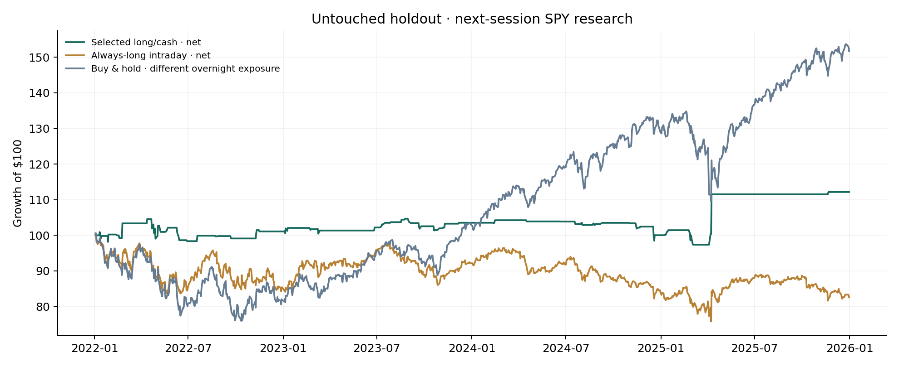

# Market Direction Prediction Using Sentiment and Economic Indicators

**A reproducible financial machine learning project by Divya Mistry.**

This project tests whether public news sentiment and macroeconomic indicators add predictive information beyond market behavior, then measures whether a long/cash SPY implementation survives trading costs. It connects public data ingestion, time-aligned features, CatBoost and Random Forest comparisons, chronological validation, financial backtesting, and an interactive research dashboard.

**[Open the live research dashboard](https://divyamistry2224.github.io/QuantDS-Projects/market-direction/)** · [Research note (PDF)](reports/market_research_note.pdf) · [Original results](reports/research_report.md) · [Model card](docs/research/model_card.md) · [Data dictionary](docs/research/data_dictionary.md) · [Notebook](notebooks/research_walkthrough.ipynb)


## Results you can inspect

All numbers below come from the committed datasets and prediction files. They are **historical research results**, not live trading performance.

| Experiment | Selection / status | Measured result |
|---|---|---|
| Original, 2022–2025 | Logistic / full features; highest 2019–2021 validation balanced accuracy and also highest mean validation net Sharpe among the compared configurations | **+12.15% net total return**, **2.92% annualized**, **0.40 net Sharpe**, **−6.98% max drawdown** |
| Original CatBoost / market + macro | Recorded model comparison, **not** the validation-selected winner | **+37.27% net total return**, **8.28% annualized**, **0.78 net Sharpe** |
| Enhanced CatBoost, Jan–Oct 2026 | 32 configurations compared on 2019–2025 development data; one winner evaluated on the fresh sample | **53.53% balanced accuracy**, **53.11% accuracy** versus **50.72% always-up accuracy** |
| Enhanced CatBoost financial overlay | Fixed 61% trading threshold, 2 bps per side; 21 active sessions | **−0.44% net total return**; directional improvement did not translate into profit in this sample |

The original buy-and-hold benchmark returned **+51.72%** with **−24.50%** maximum drawdown. It includes overnight exposure; the model strategies hold only open to close. Positive strategy returns do not imply buy-and-hold outperformance. The fresh balanced-accuracy 95% block-bootstrap interval is **48.24%–58.62%**, which includes chance. The project does not establish a statistically proven or consistently profitable edge.

The fresh winner uses **enhanced market and cross-asset features**, not the macro/sentiment additions. The ablations are important: a project can test sentiment rigorously without claiming it added value when it did not.



## What is implemented

- **Data pipeline:** SPY OHLCV and adjusted prices, five FRED series, FRBSF daily economic-news sentiment, and six cross-asset ETFs for the extension. Normalized snapshots, source URLs, UTC retrieval timestamps, and SHA-256 checksums are committed.
- **Feature engineering:** 24 original predictors; up to 43 in the extension. Momentum, volatility, moving-average distance, volume standardization, rates, term spread, CPI inflation, unemployment, sentiment levels/trends, reversal, RSI, calendar features, and relative cross-asset moves.
- **Time alignment:** backward availability joins, assumed publication lags, finite staleness limits, causal rolling transforms, next-session labels, and a five-session purge. Latest-vintage data remain a limitation.
- **Models:** CatBoost, Random Forest, standardized Logistic regression, Extra Trees, histogram gradient boosting, and a majority-class baseline.
- **Validation:** original annual expanding folds, feature ablations, and a preregistered extension with a new 2026 evaluation sample. The original weak result remains available.
- **Financial evaluation:** long/cash SPY, explicit next-open entry and same-day close exit, per-side costs, net CAGR, zero-rate Sharpe, max drawdown, hit rate, profit factor, exposure, monthly P&L, and ledger-level predictions.
- **Uncertainty & diagnostics:** calibration bins, AUC, Brier score, log loss, feature importance, and moving-block bootstrap intervals.
- **Interactive dashboard:** model/sample selectors, threshold and cost controls, equity curves with hover values, monthly heatmap, signal ledger, validation tables, and source methodology.
- **Integrity checks:** snapshot tampering, invalid OHLC, future feature mutation, backward joins, purged splits, next-session targets, round-trip accounting, drawdown, and reproducibility.

## Quick start

Python **3.12** is the tested version. Committed snapshots require **no API keys**.

```bash
git clone https://github.com/divyamistry2224/QuantDS-Projects.git
cd QuantDS-Projects/market-direction-prediction
python -m venv .venv
source .venv/bin/activate          # Windows: .venv\Scripts\activate
pip install -e '.[dev]'

market-direction verify
pytest -q
market-direction run              # Reproduce original models and artifacts
market-direction extension-run    # Reproduce the frozen 32-configuration search
market-direction profitability    # Add Extra Trees / histogram GB comparisons
```

To open the dashboard locally:

```bash
python -m http.server 8000 --directory docs
```

Visit `http://localhost:8000`. Opening `index.html` directly with `file://` will not load the JSON artifacts.

Refreshing data is optional:

```bash
market-direction fetch
market-direction extension-fetch
```

Refreshes replace the respective snapshots and checksums; source revisions may change results. To reproduce the published study, use the committed snapshots rather than refreshing them. Model fitting does not silently fetch data. Run the commands from the repository checkout; paths resolve to that checkout.

## Financial research design

**Universe:** SPY, a liquid U.S. equity ETF. **Question:** will the next trading session's close exceed its open?

```text
Public snapshots → validate & hash → engineer features → join assumed availability
       → chronological validation → select configuration → freeze model
       → evaluate predictions → apply costs & execution rules → reports + dashboard

Signal after close t → trade at open t+1 → exit close t+1 → flat overnight
```

The original experiment uses 2019, 2020 and 2021 for annual validation, with the preceding history for each training fold. Its final fit uses labels through 2021, purges five sessions, and evaluates 2022–2025. Trading uses `P(up) >= 0.55`, charging 2 bps **each side** for every active day.

After observing those results, the extension explicitly promotes 2019–2025 to development data and reserves January–October 2026 as a new evaluation period. Its [protocol was committed before evaluation](docs/research/extension_protocol.md). It compares 32 configurations and 16 classification thresholds. A CatBoost model with a rolling five-year training window wins development selection. Its 58% classification threshold and 61% trading threshold are frozen before the new evaluation.

Extra Trees and histogram gradient boosting were added after the original test had already been inspected. Their 2022–2025 comparisons are **historical backtests on a reused period**, not new independent confirmations. Dashboard threshold/cost changes likewise do not create untouched tests.

## Relevant finance skills

| Area | Evidence in this repository |
|---|---|
| Quantitative / systematic research | Testable hypothesis, baselines, ablations, validation, uncertainty and regime sensitivity |
| Asset management analytics | Explicit exposure, net returns, drawdown, turnover costs and benchmark comparison |
| Financial data engineering | Multi-source ingestion, schema validation, provenance, time alignment and reproducibility |
| Model risk / validation | Documented assumptions, independent time periods, probability diagnostics and testing history |
| Research communication | Interactive dashboard, figures, research note, model card and executable walkthrough |

This scope is most directly relevant to equity, quant, portfolio analytics and model-validation roles. It does not claim experience in every financial product or institution.

## Repository map

```text
src/market_direction/
  data.py                Public-source downloads, normalization, hashes
  features.py            Original causal transforms and availability joins
  experiment.py          Original model comparison and financial outputs
  extension.py           Enhanced features, development search, fresh evaluation
  profitability.py       Additional profit-focused historical model comparisons
  evaluation.py          Classification metrics, execution, P&L, bootstrap
  cli.py                 Reproduction commands
data/raw/                Original immutable study snapshots + provenance
experiments/v2/          Extension snapshots, selection record and predictions
reports/                 Original metrics, predictions, features and figures
notebooks/               Research walkthrough
tests/                   Integrity and accounting checks
docs/                    Static GitHub Pages dashboard and research documentation
.github/workflows/       CI checks using committed data; no external API needed
```

## Data and model limitations

Source data are downloaded as **latest revisions**, not historical point-in-time vintages. The assumed lags (two business days for daily macro series, month end +45 days for monthly series, seven days for sentiment) cannot remove vintage bias. The FRBSF variable is broad economic-news sentiment, not a company-specific signal. No model is production deployed, and there is no order execution or brokerage connection.

Model probabilities are uncalibrated. One ETF, a short fresh sample, many development comparisons and retrospective parameter decisions limit inference. Costs are assumptions rather than measured fills; cash yield, market impact, capacity, taxes and financing are omitted. SPY buy-and-hold has a different overnight-risk profile. [Read the full model card](docs/research/model_card.md).

## Sources and attribution

- [Yahoo Finance SPY history](https://finance.yahoo.com/quote/SPY/history/) — daily OHLCV and adjusted close; Yahoo chart endpoint is recorded in each manifest.
- [FRED](https://fred.stlouisfed.org/) — DFF, T10Y2Y, VIXCLS, UNRATE, CPIAUCSL. FRED republishes series from their original providers, including the Federal Reserve, BLS and Cboe.
- [Federal Reserve Bank of San Francisco Daily News Sentiment Index](https://www.frbsf.org/research-and-insights/data-and-indicators/daily-news-sentiment-index/) — economic-news sentiment; see the downloaded workbook methodology and its referenced research.
- Cross-asset ETF histories: QQQ, IWM, TLT, HYG, GLD and UUP via Yahoo Finance.

Original code and documentation: MIT. Third-party datasets retain their providers' rights and terms; this repository does not grant commercial market-data rights.
